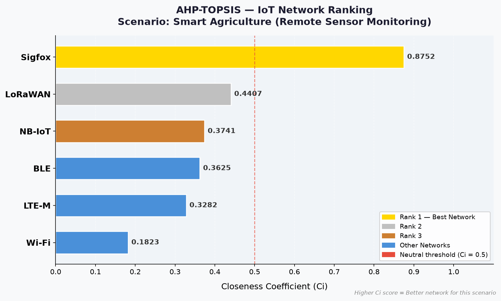
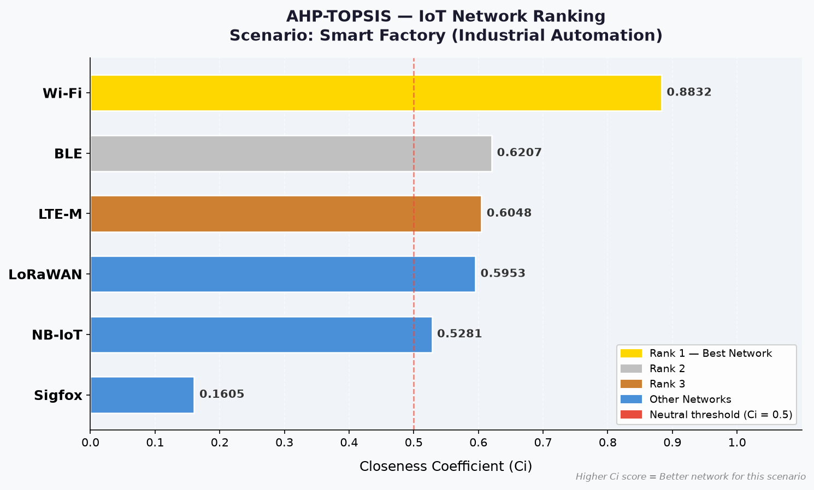
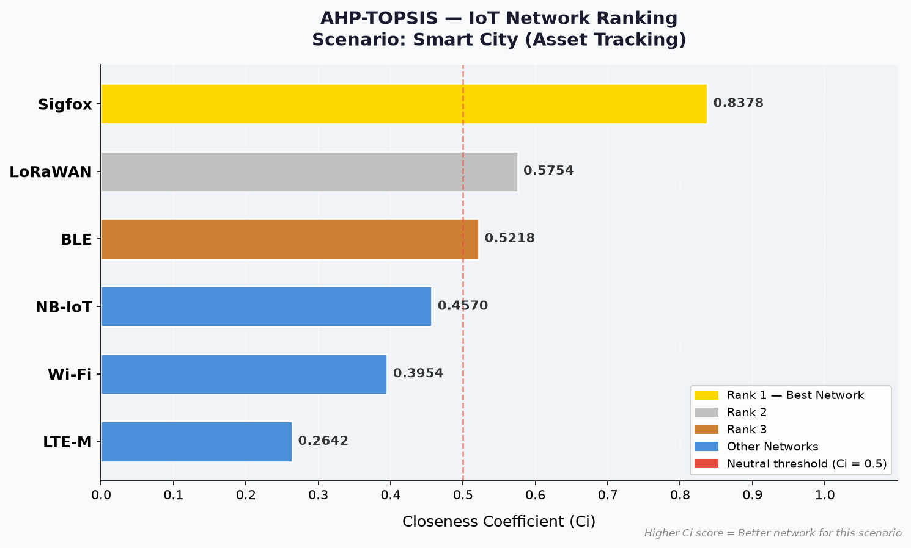

# Sélection multicritère de réseaux sans fil IoT (AHP-TOPSIS)

Outil Python d'aide à la décision qui classe six technologies de communication IoT
(LoRaWAN, Sigfox, NB-IoT, LTE-M, Wi-Fi, BLE) selon le scénario d'usage, en combinant
**AHP** pour pondérer les critères et **TOPSIS** pour classer les alternatives.

Projet de Fin d'Année (PFA) — ENSA El Jadida.

## Problème

Le choix d'un réseau sans fil pour un déploiement IoT dépend du contexte : un capteur
agricole isolé n'a pas les mêmes besoins qu'une ligne de production. Aucune technologie
n'est la meilleure sur tous les critères : il faut arbitrer entre portée, consommation,
débit, coût et latence. Les méthodes multicritères (MCDM) rendent cet arbitrage explicite
et reproductible.

## Méthode

### 1. AHP — pondération des critères

Pour chaque scénario, un expert compare les critères deux à deux sur l'échelle de Saaty
(1 = importance égale … 9 = importance extrême ; 1/3, 1/5… pour l'inverse).
On obtient une matrice réciproque `A` (n × n).

1. Normalisation des colonnes : `a'ᵢⱼ = aᵢⱼ / Σₖ aₖⱼ`
2. Poids = moyenne des lignes : `wᵢ = (1/n) Σⱼ a'ᵢⱼ`
3. Valeur propre maximale approchée : `λmax = moyenne( (A·w)ᵢ / wᵢ )`
4. Indice de cohérence : `CI = (λmax − n) / (n − 1)`
5. Ratio de cohérence : `CR = CI / RI` (RI : indice aléatoire de Saaty, 1,12 pour n = 5).
   Les jugements sont acceptés si `CR < 0,10`.

### 2. TOPSIS — classement des alternatives

1. Normalisation vectorielle : `rᵢⱼ = xᵢⱼ / √(Σₖ xₖⱼ²)`
2. Pondération par les poids AHP : `vᵢⱼ = wⱼ · rᵢⱼ`
3. Solutions idéale `A⁺` et anti-idéale `A⁻` (max pour un critère à maximiser, min pour un coût)
4. Distances euclidiennes : `Dᵢ⁺ = ‖vᵢ − A⁺‖`, `Dᵢ⁻ = ‖vᵢ − A⁻‖`
5. Coefficient de proximité : `Cᵢ = Dᵢ⁻ / (Dᵢ⁺ + Dᵢ⁻)` ∈ [0, 1] — plus il est élevé, meilleur est le réseau.

## Critères et données

| Critère | Unité | Objectif |
|---|---|---|
| Consommation d'énergie | mW | minimiser |
| Portée / couverture | km | maximiser |
| Débit | kbps | maximiser |
| Coût total | USD/an | minimiser |
| Latence | ms | minimiser |

Matrice de décision ([`data/decision_matrix.csv`](data/decision_matrix.csv)) :

| Réseau | Énergie (mW) | Portée (km) | Débit (kbps) | Coût (USD/an) | Latence (ms) |
|---|---:|---:|---:|---:|---:|
| LoRaWAN | 50 | 10 | 50 | 100 | 500 |
| Sigfox | 25 | 40 | 0,1 | 50 | 6000 |
| NB-IoT | 300 | 10 | 250 | 200 | 1500 |
| LTE-M | 400 | 10 | 1000 | 400 | 100 |
| Wi-Fi | 1000 | 0,1 | 54000 | 150 | 10 |
| BLE | 15 | 0,1 | 1000 | 80 | 10 |

Ce sont des **ordres de grandeur typiques** de chaque technologie, pas des mesures.
Les résultats dépendent directement de ces valeurs : les modifier dans le CSV suffit à
refaire l'analyse.

## Scénarios IoT

Les matrices de comparaison par paires sont dans [`data/scenarios/`](data/scenarios/).

| Scénario | Priorités |
|---|---|
| 1. Agriculture intelligente (capteurs distants) | portée et faible consommation ; débit et latence peu importants |
| 2. Usine intelligente (automatisation industrielle) | latence très faible et débit élevé |
| 3. Ville intelligente (suivi d'actifs) | coût et couverture, puis énergie |

Un 4ᵉ scénario permet de saisir sa propre matrice en mode interactif.

## Résultats

Générés par `python run_all.py` (détail complet : [`results/summary.md`](results/summary.md)).

**Poids AHP** (toutes les matrices sont cohérentes, CR < 0,10) :

| Scénario | Énergie | Portée | Débit | Coût | Latence | CR |
|---|---:|---:|---:|---:|---:|---:|
| Agriculture | 0,256 | 0,480 | 0,062 | 0,164 | 0,038 | 0,024 |
| Usine | 0,067 | 0,042 | 0,295 | 0,112 | 0,485 | 0,011 |
| Ville | 0,192 | 0,300 | 0,072 | 0,394 | 0,043 | 0,019 |

**Classement TOPSIS** (coefficient Cᵢ) :

| Rang | Agriculture | Usine | Ville |
|---:|---|---|---|
| 1 | Sigfox (0,875) | Wi-Fi (0,883) | Sigfox (0,838) |
| 2 | LoRaWAN (0,441) | BLE (0,621) | LoRaWAN (0,575) |
| 3 | NB-IoT (0,374) | LTE-M (0,605) | BLE (0,522) |
| 4 | BLE (0,363) | LoRaWAN (0,595) | NB-IoT (0,457) |
| 5 | LTE-M (0,328) | NB-IoT (0,528) | Wi-Fi (0,395) |
| 6 | Wi-Fi (0,182) | Sigfox (0,161) | LTE-M (0,264) |

| Agriculture | Usine | Ville |
|---|---|---|
|  |  |  |

Lecture : les technologies LPWAN (Sigfox, LoRaWAN) dominent quand portée, énergie et
coût priment ; le Wi-Fi l'emporte quand latence et débit sont décisifs. TOPSIS mesure une
proximité relative à l'idéal : un écart faible entre deux réseaux (ex. BLE / LTE-M / LoRaWAN
dans le scénario usine) indique un choix peu tranché, sensible aux données d'entrée.

## Installation et utilisation

```bash
git clone https://github.com/Harchoune/IoT-MCDM-PFA2.git
cd IoT-MCDM-PFA2
python -m venv .venv
source .venv/bin/activate
pip install -r requirements.txt

python run_all.py     # les 3 scénarios → results/ (CSV, Markdown) et figures/ (PNG)
python main.py        # mode interactif (choix du scénario, matrice personnalisée)
pytest                # tests
```

## Structure

```
ahp.py                  calcul AHP (poids, λmax, CI, CR) + saisie manuelle
topsis.py               calcul TOPSIS (normalisation, idéaux, distances, Cᵢ)
chart.py                graphique de classement (matplotlib)
main.py                 interface interactive en ligne de commande
run_all.py              exécution reproductible des 3 scénarios
data/
  decision_matrix.csv   performances des réseaux
  criteria.csv          critères (unité, min/max)
  scenarios/*.csv       matrices de comparaison AHP par scénario
  networks.py           chargement des CSV
results/                classements et poids générés
figures/                graphiques générés
tests/                  tests pytest (AHP, TOPSIS, scénarios)
```

## Limites

- Les valeurs de la matrice de décision sont indicatives (ordres de grandeur) ;
  une étude réelle doit les sourcer (fiches techniques, mesures terrain, offres opérateurs).
- Les comparaisons AHP reflètent un jugement d'expert : une analyse de sensibilité
  sur les poids permettrait de vérifier la robustesse du classement.
- TOPSIS avec normalisation vectorielle est sensible aux valeurs extrêmes
  (ex. débit Wi-Fi de 54 Mbps).

## Licence

[MIT](LICENSE) — © 2026 HARCHOUNE Abdellah
