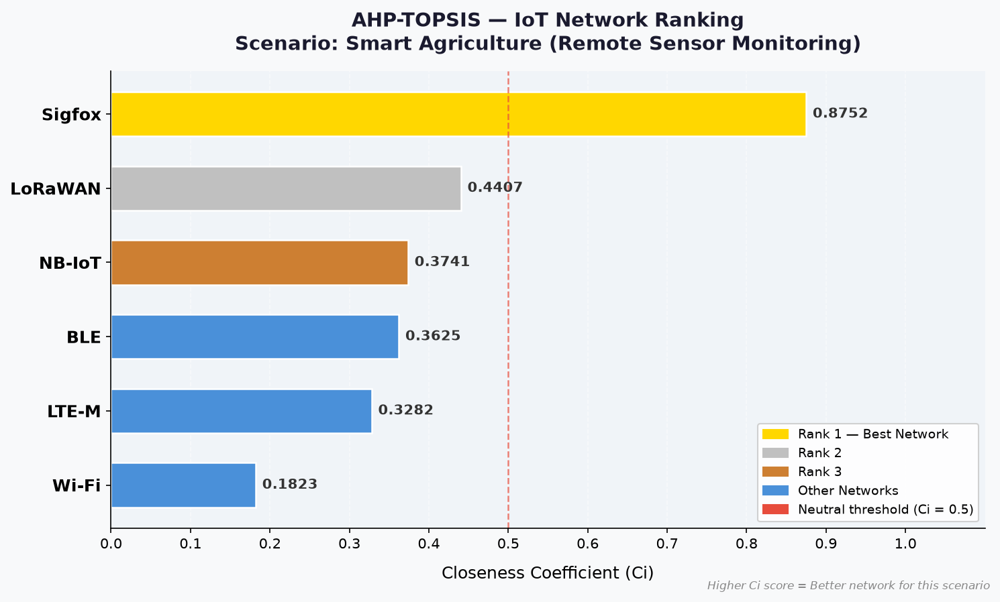
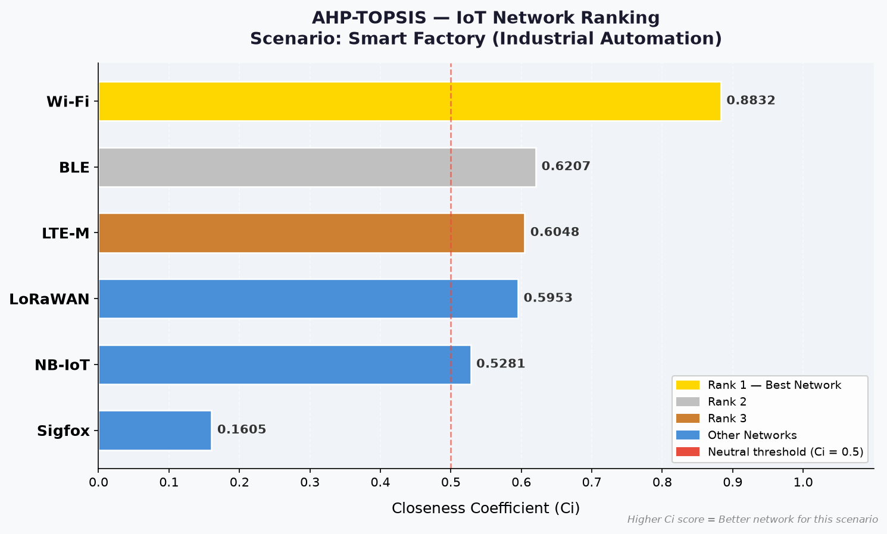
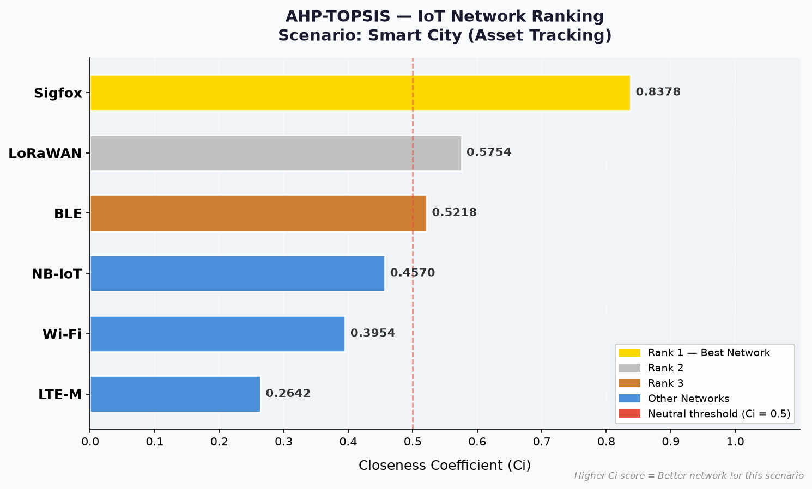

# Résultats AHP-TOPSIS (générés par `python run_all.py`)

## Poids AHP des critères

| scenario                                     |   Energy Consumption |   Range / Coverage |   Data Rate |   Total Cost |   Latency |   lambda_max |     CI |     CR | consistent   |
|:---------------------------------------------|---------------------:|-------------------:|------------:|-------------:|----------:|-------------:|-------:|-------:|:-------------|
| Smart Agriculture (Remote Sensor Monitoring) |               0.2562 |             0.4797 |      0.0621 |       0.164  |    0.038  |       5.1062 | 0.0266 | 0.0237 | True         |
| Smart Factory (Industrial Automation)        |               0.0668 |             0.0415 |      0.2948 |       0.112  |    0.485  |       5.0503 | 0.0126 | 0.0112 | True         |
| Smart City (Asset Tracking)                  |               0.1917 |             0.2996 |      0.0715 |       0.3943 |    0.0428 |       5.0827 | 0.0207 | 0.0185 | True         |

## 1. Smart Agriculture (Remote Sensor Monitoring)

Cohérence AHP : CR = 0.0237 (cohérent, seuil 0,10)

|   rank | network   |   closeness_Ci |   D_plus |   D_minus |
|-------:|:----------|---------------:|---------:|----------:|
|      1 | Sigfox    |         0.8752 |   0.0722 |    0.5062 |
|      2 | LoRaWAN   |         0.4407 |   0.3365 |    0.2651 |
|      3 | NB-IoT    |         0.3741 |   0.3459 |    0.2067 |
|      4 | BLE       |         0.3625 |   0.4434 |    0.2521 |
|      5 | LTE-M     |         0.3282 |   0.3662 |    0.179  |
|      6 | Wi-Fi     |         0.1823 |   0.4947 |    0.1103 |

## 2. Smart Factory (Industrial Automation)

Cohérence AHP : CR = 0.0112 (cohérent, seuil 0,10)

|   rank | network   |   closeness_Ci |   D_plus |   D_minus |
|-------:|:----------|---------------:|---------:|----------:|
|      1 | Wi-Fi     |         0.8832 |   0.0736 |    0.5561 |
|      2 | BLE       |         0.6207 |   0.2918 |    0.4775 |
|      3 | LTE-M     |         0.6048 |   0.3023 |    0.4626 |
|      4 | LoRaWAN   |         0.5953 |   0.2984 |    0.439  |
|      5 | NB-IoT    |         0.5281 |   0.3191 |    0.3572 |
|      6 | Sigfox    |         0.1605 |   0.5532 |    0.1058 |

## 3. Smart City (Asset Tracking)

Cohérence AHP : CR = 0.0185 (cohérent, seuil 0,10)

|   rank | network   |   closeness_Ci |   D_plus |   D_minus |
|-------:|:----------|---------------:|---------:|----------:|
|      1 | Sigfox    |         0.8378 |   0.0826 |    0.4266 |
|      2 | LoRaWAN   |         0.5754 |   0.222  |    0.3008 |
|      3 | BLE       |         0.5218 |   0.2841 |    0.31   |
|      4 | NB-IoT    |         0.457  |   0.2541 |    0.2138 |
|      5 | Wi-Fi     |         0.3954 |   0.3318 |    0.217  |
|      6 | LTE-M     |         0.2642 |   0.3615 |    0.1298 |

